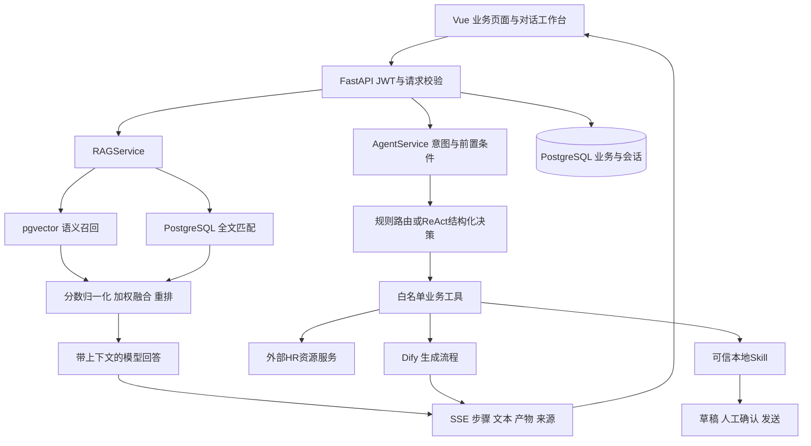

# HR Recruitment Agent

一个把自然语言任务、招聘业务产物、企业知识库与培训测验连接起来的工作台。用户可以描述岗位需求、调整评分规则、处理候选材料、生成沟通方案或测验，并在聊天中查看执行步骤、结构化结果及后续操作。邮件以草稿和人工确认两个阶段执行。

这是一个个人独立开发项目，重点探索受约束的Agent工具编排、业务系统集成、RAG知识问答与可交互的生成流程。

[系统架构](docs/architecture.md) · [配置与运行](docs/setup.md) · [开发与验证](docs/development.md)

## 为什么做这个项目

岗位说明、评分标准、候选评价、沟通安排和培训材料通常分散在不同页面或系统。仅添加一个聊天框，并不能解决资源如何关联、缺少条件时怎么办、生成后保存在哪里、哪些动作必须确认等问题。

本项目保留常规业务页面，同时增加自然语言入口。Agent把需求映射到受支持的工具，检查附件与业务前置条件，返回可编辑的表单、产物卡片和执行步骤；知识问答使用独立检索链路，邮件发送通过显式确认控制副作用。

## 核心功能

| 模块 | 可以做什么 | 代码入口 |
| --- | --- | --- |
| 统一Agent入口 | 普通对话、规则优先路由、ReAct式结构化决策、工具分发 | [AgentService](backend/app/services/agent_service.py) |
| 岗位与评分 | 解析需求、生成岗位说明及评分标准、保存与继续修改 | [业务资源](backend/app/services/_agent_service_resources.py)、[编辑链路](backend/app/services/_agent_service_editing.py) |
| 候选材料处理 | 接收材料、选择岗位、生成评价、匹配候选资源 | [评价服务](backend/app/services/resume_evaluation_service.py) |
| 沟通方案 | 根据已评价候选人与岗位信息生成结构化方案 | [方案服务](backend/app/services/interview_plan_service.py) |
| 企业知识库 | 文档上传、去重、解析、语义分块、向量入库及管理 | [文档服务](backend/app/services/enhanced_document_service.py) |
| RAG问答 | 查询改写、向量与全文双路检索、加权融合、可选重排与来源返回 | [RAGService](backend/app/services/rag_service.py) |
| 培训测验 | 基于文档出题、题量与分值配置、客观题判分、简答题评分 | [ExamService](backend/app/services/exam_service.py) |
| 邮件Skill | 动态加载可信本地技能，先生成草稿，确认后调用发送阶段 | [Skill运行时](backend/app/services/agent_skills.py)、[邮件清单](backend/skills/hr-agent-email/skill.json) |
| 会话与界面 | 会话记录、执行步骤、产物卡片、候选选择及SSE增量展示 | [前端源码](frontend/src)、[Agent协议](backend/app/schemas/agent.py) |
| 账号与资源 | JWT登录、用户管理、会话与知识资源归属 | [API依赖](backend/app/api/deps.py)、[数据模型](backend/app/models) |

## 两个典型使用流程

### 从岗位需求到业务产物

1. 输入岗位名称、地点、薪资、经验和技能要求。
2. Agent解析结构化条件；缺少关键字段时返回待补全表单。
3. 确认后生成岗位说明，再根据该说明生成评分标准。
4. 保存真实资源ID，后续可以继续修改岗位或规则。
5. 添加候选材料并选择岗位，逐份生成评价；再基于已保存候选资源生成沟通方案。

### 从文档到问答与培训

1. 创建知识库并上传业务文档。
2. 检查处理状态，完成解析、分块和向量化。
3. 提问时合并语义召回与全文匹配，必要时重排，回答附带来源。
4. 选择知识文件，设置题型数量、难度和时长，生成测验。
5. 提交答案后，本地判断客观题，调用生成服务评阅简答题，保存逐题结果与总分。

## 系统架构



Agent的核心控制器采用规则与ReAct式JSON决策，具体业务由服务方法执行，当前不是LangGraph状态图。RAG融合采用可配置加权分数，不是RRF；邮件Skill是受信任的本地脚本扩展，不是任意远端MCP工具接入。

## 技术栈与设计

| 层次 | 技术 | 用途 |
| --- | --- | --- |
| 前端 | Vue 3、Vite、Element Plus、Pinia、Vue Router、Axios | 业务页面、状态、路由与交互 |
| 服务 | FastAPI、Pydantic、异步Python、httpx | 请求约束、服务编排与流式调用 |
| 数据 | PostgreSQL、SQLAlchemy Async、asyncpg | 用户、会话、文档、测验和结果 |
| 检索 | pgvector、PostgreSQL全文匹配、Qwen Rerank | 企业知识问答与来源定位 |
| 生成 | OpenAI兼容聊天接口、Dify Chatflow | 需求解析、业务生成与评分 |
| Agent协议 | 白名单工具、ReActDecision、AgentStep、AgentArtifact | 限定动作并显示可检查过程 |
| 技能 | SKILL.md、skill.json、Python阶段脚本 | 邮件草稿与人工确认发送 |
| 认证 | JWT、密码哈希及用户依赖 | 身份与资源访问控制 |

控制器不直接把任意模型文本当作数据库操作。模型输出先映射到允许的意图，再进入有明确前置条件的业务分支。生成内容与已保存资源ID分开表示，避免把“已生成”误当作“已成功保存”。

## 核心代码结构

```text
backend/
  main.py                     应用启动、数据库与邮件调度
  app/api/                    账号、Agent、知识库和业务接口
  app/core/                   配置、认证、数据库与异常处理
  app/models/                 业务数据库模型
  app/schemas/                请求、产物与流式协议
  app/services/
    agent_service.py          统一入口和业务路由
    _agent_service_core.py    工具、决策、记忆与流式编排
    _agent_service_resources.py 业务资源与结果处理
    _agent_service_editing.py 修改与候选资源定位
    agent_skills.py           可信本地技能装载与分发
    rag_service.py            检索与回答
    enhanced_document_service.py 文档解析与分块
    dify_service.py           Dify HTTP与SSE适配
  skills/hr-agent-email/      邮件技能定义和阶段脚本
frontend/src/                 Vue页面、组件、状态和API
docs/                         架构、配置与开发说明
```

## 快速开始

需要Python 3.11、Node.js、带vector扩展的PostgreSQL，以及自己的模型服务。业务生成依赖Dify应用，岗位等远程资源读写还需要实现对应接口的HR服务。

```bash
git clone https://github.com/amazingLH/hr-recruitment-agent.git
cd hr-recruitment-agent/backend
python -m venv .venv
# Windows：.venv\Scripts\activate
# Linux/macOS：source .venv/bin/activate
python -m pip install -r requirements.txt
```

复制`.env.example`为`.env`并填写配置，然后在`backend`运行：

```bash
uvicorn main:app --host 127.0.0.1 --port 8001
```

另开终端进入`frontend`，执行`npm ci`和`npm run dev`，访问`http://localhost:3001`。Dify输入类型、外部服务契约与向量维度说明见[配置与运行](docs/setup.md)。

## 评测结果

| 指标 | 结果 | 评测范围 |
| --- | --- | --- |
| Agent回归规模 | 150个测试用例各运行3轮，共450次执行 | 招聘编排、知识问答、邮件确认及业务边界 |
| 意图识别准确率 | 95.56% | 同组Agent测试用例 |
| 人工确认判断准确率 | 99.11% | 是否需要人工确认的决策检查 |
| 输出契约通过率 | 99.33% | 步骤、产物类型及必需字段检查 |
| 知识检索 | Recall@5为94.17% | 120个知识问答样本 |
| 回答正确性 | RAGAS平均得分0.91 | 同组问答的生成答案与参考答案 |

指标定义、分层范围和统计方法见[开发与验证](docs/development.md)及[评测模块](benchmarks/evaluation/README.md)。

## 后续改进

- 提供可直接导入的Dify应用配置与独立HR资源适配器。
- 为外部写入和邮件发送增加持久化确认记录、幂等键和失败对账。
- 增加文档处理任务队列、检索消融和更完整的跨用户回归。
- 明确生成产物版本、来源、修改历史与资源授权关系。

## 文档导航

| 文档 | 内容 |
| --- | --- |
| [系统架构](docs/architecture.md) | 路由、工具、Skill、RAG、文档、资源与前后端协议 |
| [配置与运行](docs/setup.md) | 数据库、模型、Dify、远程服务、邮件与启动检查 |
| [开发与验证](docs/development.md) | 主要接口、事件、验证矩阵、指标与功能扩展 |

## 评测协议与结果汇总

[评测模块](benchmarks/evaluation/README.md)定义分层测试范围、指标分母、证据记录和结果汇总命令。范围配置与实际结果分开保存，汇总报告同时输出覆盖检查及原始记录指纹。
